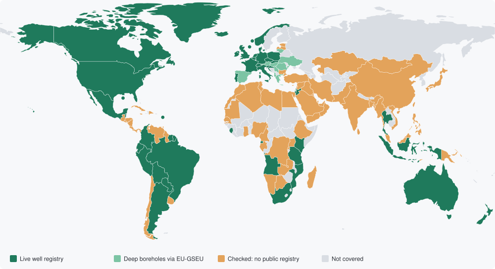

# well-data-mcp

MCP server for oil & gas and geothermal **well data worldwide**, pulled live from the
public services of state, provincial and national regulators and geological surveys.
No API keys, no accounts, no scraping of pages meant for people: these are the same
ArcGIS, WFS and query endpoints the agencies' own map viewers use.

It answers questions like "which wells does Fervo have at Cape Station", "every well
within 2 km of this pad", "look up API 30-025-36283", "what was pumped into this well's
frac job", "bottom-hole temperatures in Weld County", "orphaned wells in this county",
"Equinor's wellbores on the Norwegian shelf" or "geothermal wells near Larderello" -
and says plainly when a country publishes nothing machine-readable.



<!-- coverage:start (generated by `node scripts/coverage-table.js`) -->

## Coverage

### United States

| Key | Coverage | Agency | Via |
|---|---|---|---|
| `CA-OG` | California oil & gas wells | CalGEM (WellSTAR) | ArcGIS |
| `CA-GEO` | California geothermal wells | CalGEM (WellSTAR) | ArcGIS |
| `UT` | Utah oil & gas wells | Utah Division of Oil, Gas & Mining (DOGM) | ArcGIS |
| `UT-GEO` | Utah deep geothermal wells (incl. Fervo Cape Station, Utah FORGE) | Utah Division of Water Rights (DWRi) | ArcGIS |
| `UT-WLOG` | Utah drilled-well logs (every well drilled under a water-rights approval, incl. geothermal) | Utah Division of Water Rights (DWRi) | ArcGIS |
| `UT-THERMAL` | Utah thermal wells and springs (temperature + water chemistry) | Utah Geological Survey (UGS) | ArcGIS |
| `NM` | New Mexico oil & gas wells | NM OCD (EMNRD) | ArcGIS |
| `CO` | Colorado wells (API spots) | Colorado ECMC (via DNR GIS) | ArcGIS |
| `WY` | Wyoming oil & gas wells (WOGCC database snapshot) | Wyoming State Geological Survey (copy of the WOGCC well database) | ArcGIS |
| `WY-LIVE` | Wyoming wells - live WOGCC list (name, status, type) | Wyoming Oil and Gas Conservation Commission (WOGCC) Data Explorer | WFS |
| `MT` | Montana oil & gas wells | Montana Board of Oil & Gas Conservation (DNRC) | ArcGIS |
| `ID-OG` | Idaho oil & gas wells | Idaho Geological Survey | ArcGIS |
| `ID-GEO` | Idaho geothermal wells (low-temperature use, with water temperatures) | Idaho Department of Water Resources (IDWR) | ArcGIS |
| `OR-GEO` | Oregon geothermal wells and temperature-gradient holes (incl. Newberry) | Oregon DOGAMI (GTILO-2 compilation) | ArcGIS |
| `WA-OG` | Washington oil & gas wells | Washington DNR (Geology) | ArcGIS |
| `WA-GEO` | Washington geothermal well permits | Washington DNR (Geology) | ArcGIS |
| `AZ` | Arizona oil, gas, helium & geothermal wells | Arizona Oil & Gas Conservation Commission (hosted by ADEQ) | ArcGIS |
| `NV-GEO` | Nevada geothermal wells | NBMG (UNR) / NGDS | ArcGIS |
| `NV-OG` | Nevada oil & gas wells (compiled through 2013) | NBMG (UNR) | ArcGIS |
| `NV-NBMG` | Great Basin boreholes - Nevada and neighbours (geothermal, oil & gas, groundwater, mining), current | Nevada Bureau of Mines and Geology (University of Nevada, Reno) subsurface database | ArcGIS |
| `AK` | Alaska oil, gas & geothermal wells (incl. state offshore) | Alaska Oil and Gas Conservation Commission (via Alaska Division of Oil & Gas) | ArcGIS |
| `HI-GEO` | Hawaii geothermal wells (Puna) | Hawaii Statewide GIS Program | ArcGIS |
| `SD` | South Dakota oil & gas wells | South Dakota Geological Survey / DANR | ArcGIS |
| `ND` | North Dakota oil & gas wells | ND DMR Oil & Gas Division | ArcGIS |
| `TX` | Texas well locations (location + API only) | Texas RRC public GIS | ArcGIS |
| `TX-RRC` | Texas wellbores with operator, lease, field and county | Texas Railroad Commission (EWA wellbore query) | RRC query |
| `OK` | Oklahoma oil, gas & injection wells | Oklahoma Corporation Commission (RBDMS) | ArcGIS |
| `KS` | Kansas oil & gas wells | Kansas Geological Survey (KCC well data) | ArcGIS |
| `NE` | Nebraska oil & gas wells (API, name, location) | Nebraska Oil & Gas Conservation Commission | WFS |
| `MO` | Missouri oil & gas wells | Missouri DNR / Missouri Geological Survey | ArcGIS |
| `AR` | Arkansas oil & gas wells | Arkansas Oil and Gas Commission (via Arkansas GIS Office) | ArcGIS |
| `LA` | Louisiana oil & gas wells (incl. state waters) | Louisiana DENR Office of Conservation (SONRIS) | ArcGIS |
| `MS` | Mississippi oil & gas wells | Mississippi State Oil & Gas Board | WFS |
| `AL` | Alabama oil, gas & coalbed-methane wells | State Oil and Gas Board of Alabama (via Geological Survey of Alabama) | ArcGIS |
| `FL` | Florida oil & gas wells | Florida Department of Environmental Protection, Oil and Gas Program | ArcGIS |
| `PA` | Pennsylvania oil & gas wells | Pennsylvania DEP Office of Oil and Gas Management | ArcGIS |
| `OH` | Ohio oil & gas wells | Ohio DNR Division of Oil & Gas Resources | ArcGIS |
| `WV` | West Virginia oil & gas wells | West Virginia DEP Office of Oil and Gas | ArcGIS |
| `KY` | Kentucky oil & gas wells | Kentucky Geological Survey | ArcGIS |
| `IL` | Illinois oil & gas wells | Illinois State Geological Survey (ILOIL) | ArcGIS |
| `IN` | Indiana oil & gas wells | Indiana DNR Division of Oil & Gas | ArcGIS |
| `MI` | Michigan oil, gas & mineral wells | Michigan EGLE (Oil, Gas, and Minerals Division) | ArcGIS |
| `NY` | New York oil, gas & solution-mining wells | New York DEC Division of Mineral Resources | ArcGIS |
| `TN` | Tennessee oil & gas wells | Tennessee Department of Environment and Conservation (TDEC) | ArcGIS |
| `VA` | Virginia gas & oil wells (active) | Virginia Energy, Division of Gas and Oil | ArcGIS |
| `VA-HIST` | Virginia oil & gas wells - historic, incl. plugged and abandoned | Virginia Energy, Division of Geology and Mineral Resources (compiled for the National Geothermal Data System) | ArcGIS |
| `CO-BHT` | Colorado borehole temperatures (bottom-hole and log temperatures by well) | Colorado state geological survey data in the National Geothermal Data System (AASG), served by the Nevada Bureau of Mines and Geology | ArcGIS |
| `ID-BHT` | Idaho borehole temperatures (bottom-hole and log temperatures by well) | Idaho state geological survey data in the National Geothermal Data System (AASG), served by the Nevada Bureau of Mines and Geology | ArcGIS |
| `MT-BHT` | Montana borehole temperatures (bottom-hole and log temperatures by well) | Montana state geological survey data in the National Geothermal Data System (AASG), served by the Nevada Bureau of Mines and Geology | ArcGIS |
| `NV-BHT` | Nevada borehole temperatures (bottom-hole and log temperatures by well) | Nevada state geological survey data in the National Geothermal Data System (AASG), served by the Nevada Bureau of Mines and Geology | ArcGIS |
| `SD-BHT` | South Dakota borehole temperatures (bottom-hole and log temperatures by well) | South Dakota state geological survey data in the National Geothermal Data System (AASG), served by the Nevada Bureau of Mines and Geology | ArcGIS |
| `UT-BHT` | Utah borehole temperatures (bottom-hole and log temperatures by well) | Utah state geological survey data in the National Geothermal Data System (AASG), served by the Nevada Bureau of Mines and Geology | ArcGIS |
| `WY-BHT` | Wyoming borehole temperatures (bottom-hole and log temperatures by well) | Wyoming state geological survey data in the National Geothermal Data System (AASG), served by the Nevada Bureau of Mines and Geology | ArcGIS |
| `IL-BHT` | Illinois borehole temperatures (bottom-hole and log temperatures by well) | Illinois state geological survey data in the National Geothermal Data System (AASG), served by the Illinois State Geological Survey | ArcGIS |
| `IN-BHT` | Indiana borehole temperatures (bottom-hole and log temperatures by well) | Indiana state geological survey data in the National Geothermal Data System (AASG), served by the Illinois State Geological Survey | ArcGIS |
| `MA-BHT` | Massachusetts borehole temperatures (bottom-hole and log temperatures by well) | Massachusetts state geological survey data in the National Geothermal Data System (AASG), served by the Illinois State Geological Survey | ArcGIS |
| `MI-BHT` | Michigan borehole temperatures (bottom-hole and log temperatures by well) | Michigan state geological survey data in the National Geothermal Data System (AASG), served by the Illinois State Geological Survey | ArcGIS |
| `MO-BHT` | Missouri borehole temperatures (bottom-hole and log temperatures by well) | Missouri state geological survey data in the National Geothermal Data System (AASG), served by the Illinois State Geological Survey | ArcGIS |
| `NY-BHT` | New York borehole temperatures (bottom-hole and log temperatures by well) | New York state geological survey data in the National Geothermal Data System (AASG), served by the Illinois State Geological Survey | ArcGIS |
| `OH-BHT` | Ohio borehole temperatures (bottom-hole and log temperatures by well) | Ohio state geological survey data in the National Geothermal Data System (AASG), served by the Illinois State Geological Survey | ArcGIS |
| `PA-BHT` | Pennsylvania borehole temperatures (bottom-hole and log temperatures by well) | Pennsylvania state geological survey data in the National Geothermal Data System (AASG), served by the Illinois State Geological Survey | ArcGIS |
| `VT-BHT` | Vermont borehole temperatures (bottom-hole and log temperatures by well) | Vermont state geological survey data in the National Geothermal Data System (AASG), served by the Illinois State Geological Survey | ArcGIS |
| `WV-BHT` | West Virginia borehole temperatures (bottom-hole and log temperatures by well) | West Virginia state geological survey data in the National Geothermal Data System (AASG), served by the West Virginia Geological and Economic Survey | ArcGIS |
| `IA` | Iowa wells (Iowa Geological Survey GeoSam: water, exploration, gas-storage and oil tests) | Iowa Geological Survey (GeoSam) data in the National Geothermal Data System, served by the Illinois State Geological Survey | ArcGIS |
| `US-ORPHAN` | US documented unplugged orphaned oil & gas wells (USGS national dataset, from state regulators) | U.S. Geological Survey - Documented Unplugged Orphaned Oil and Gas Well dataset (DOI 10.5066/P13FHBYG) | ArcGIS |
| `US-BLM-NM` | BLM applications for permit to drill (APDs) on federal minerals - New Mexico, Oklahoma, Kansas, Texas | Bureau of Land Management, New Mexico State Office | ArcGIS |
| `US-FRACFOCUS` | US hydraulic-fracturing disclosures (one record per frac job, with the chemical list) | FracFocus (Ground Water Protection Council / Interstate Oil & Gas Compact Commission) | FracFocus API |

### US federal offshore

| Key | Coverage | Agency | Via |
|---|---|---|---|
| `OCS-GOM` | US Gulf federal offshore wells (Outer Continental Shelf) | BOEM / BSEE (federal offshore) | ArcGIS |
| `OCS-PAC` | US Pacific federal offshore wells (Outer Continental Shelf) | BOEM / BSEE (federal offshore) | ArcGIS |
| `OCS-AK` | US Alaska federal offshore wells (Outer Continental Shelf) | BOEM / BSEE (federal offshore) | ArcGIS |
| `OCS-ATL` | US Atlantic federal offshore wells (Outer Continental Shelf) | BOEM / BSEE (federal offshore) | ArcGIS |

### Canada

| Key | Coverage | Agency | Via |
|---|---|---|---|
| `SK` | Saskatchewan oil & gas wells (vertical) | Saskatchewan Ministry of Energy and Resources | ArcGIS |
| `SK-HZ` | Saskatchewan oil & gas wells (horizontal / directional) | Saskatchewan Ministry of Energy and Resources | ArcGIS |
| `BC` | British Columbia oil & gas wells | BC Energy Regulator (BCER) | ArcGIS |
| `ON` | Ontario oil, gas, salt & storage wells (incl. Lake Erie) | Ontario Ministry of Natural Resources (Land Information Ontario) | ArcGIS |
| `NL-OFF` | Newfoundland & Labrador offshore wells | Newfoundland and Labrador Department of Industry, Energy and Technology | ArcGIS |
| `NS-OFF` | Nova Scotia offshore wells | Canada-Nova Scotia Offshore Energy Board directory (via NRCan) | ArcGIS |
| `NT` | Northwest Territories oil & gas wells | NWT Office of the Regulator of Oil and Gas Operations (OROGO) | ArcGIS |
| `YT` | Yukon oil & gas wells | Government of Yukon (Oil and Gas Resources Branch) | ArcGIS |
| `YT-GEO` | Yukon geothermal boreholes (temperature, gradient, heat flow) | Yukon Geological Survey | ArcGIS |
| `AB` | Alberta wells - AER ST37 well list locations and status (March 2024) | Alberta Energy Regulator ST37 list, mapped by the Alberta Geological Survey | ArcGIS |
| `AB-GEO-SWANHILLS` | Alberta wells reaching the Swan Hills / Slave Point formations - formation depth and temperature (geothermal resource assessment) | Alberta Geological Survey / Alberta Energy Regulator | ArcGIS |
| `AB-GEO-GRANITEWASH` | Alberta wells reaching the Granite Wash - formation depth and temperature (geothermal resource assessment) | Alberta Geological Survey / Alberta Energy Regulator | ArcGIS |
| `AB-GEO-LEDUC` | Alberta wells reaching the Leduc Formation - formation depth and temperature (geothermal resource assessment) | Alberta Geological Survey / Alberta Energy Regulator | ArcGIS |
| `MB` | Manitoba oil & gas wells | Manitoba Petroleum Branch (Economic Development, Investment, Trade and Natural Resources) | Shapefile download |
| `QC` | Quebec oil & gas wells and stratigraphic holes | Québec Ministère des Ressources naturelles et des Forêts (hydrocarbon wells) | ArcGIS |
| `NS-ON` | Nova Scotia onshore petroleum wells | Nova Scotia Department of Natural Resources (onshore petroleum wells) | ArcGIS |
| `NB` | New Brunswick producing oil & gas wells | New Brunswick Department of Natural Resources and Energy Development (GeoNB oil & gas viewer) | ArcGIS |

### Latin America & Caribbean

| Key | Coverage | Agency | Via |
|---|---|---|---|
| `BZ` | Belize exploration & production wells (onshore and offshore) | Government of Belize - petroleum data coverage map (Geology & Petroleum Department data) | ArcGIS |
| `MX` | Mexico oil & gas wells (onshore and offshore) | CNH well inventory as re-hosted by SEMARNAT | ArcGIS |
| `CO-EPIS` | Colombia oil & gas wells | Servicio Geológico Colombiano (EPIS) | ArcGIS |
| `BR-ANP` | Brazil oil & gas wells (onshore and offshore, incl. pre-salt) | ANP - Agência Nacional do Petróleo, Gás Natural e Biocombustíveis | WFS |
| `PE` | Peru oil & gas wells | PERUPETRO | WFS |
| `AR-CONV` | Argentina oil & gas wells - conventional | Secretaría de Energía de la Nación (Argentina) | WFS (FES) |
| `AR-SHALE` | Argentina oil & gas wells - shale (Vaca Muerta...) | Secretaría de Energía de la Nación (Argentina) | WFS (FES) |
| `AR-TIGHT` | Argentina oil & gas wells - tight | Secretaría de Energía de la Nación (Argentina) | WFS (FES) |
| `AR-OTHER` | Argentina oil & gas wells - resource type not reported | Secretaría de Energía de la Nación (Argentina) | WFS (FES) |
| `AR-NQN` | Argentina - Neuquén province wells incl. Vaca Muerta (provincial registry, more detail than AR-*) | Provincia del Neuquén - Subsecretaría de Energía, Minería e Hidrocarburos | WFS |
| `BR-SIAGAS` | Brazil groundwater wells incl. deep and thermal wells (SIAGAS national register) | Serviço Geológico do Brasil (SGB) - SIAGAS | WFS |
| `BO` | Bolivia oil & gas wells | Ministerio de Hidrocarburos y Energías de Bolivia (Viceministerio de Exploración y Explotación) | ArcGIS |
| `CO-GEO` | Colombia deep oil & gas wells with bottom-hole temperatures and geothermal gradients | Servicio Geológico Colombiano (Mapa Geotérmico de Colombia, ANH well data) | ArcGIS |
| `PY` | Paraguay petroleum wells (all ~50 drilled since 1947) | Viceministerio de Minas y Energía de Paraguay | ArcGIS |
| `SR` | Suriname wells in Staatsolie's data room (mostly offshore exploration) | Staatsolie Maatschappij Suriname (state oil company) - GeoPortal | ArcGIS |
| `EC` | Ecuador oil & gas wells (unofficial copy of the 2020 ministry consolidation) | Ecuador Ministry of Energy (MERNNR) well data, 2020, re-hosted on ArcGIS Online by GEOcentro, Universidad San Francisco de Quito | ArcGIS |

### Europe

| Key | Coverage | Agency | Via |
|---|---|---|---|
| `FR-BSS` | France boreholes incl. overseas departments (Guadeloupe/Bouillante, Martinique, Réunion...) | BRGM - Banque du Sous-Sol (BSS) | WFS (FES) |
| `NO-SODIR` | Norway offshore wellbores (all: exploration, development, other) | Sodir - Norwegian Offshore Directorate (FactMaps) | ArcGIS |
| `GB-NSTA-OFF` | UK offshore wellbores (UKCS) | North Sea Transition Authority (NSTA) | ArcGIS |
| `GB-NSTA-ON` | England onshore petroleum wells | North Sea Transition Authority (NSTA) | ArcGIS |
| `GB-BGS` | Great Britain borehole index (all onshore drilling, incl. deep geothermal) | British Geological Survey (Single Onshore Borehole Index) | ArcGIS |
| `NL-NLOG` | Netherlands deep boreholes (oil, gas, geothermal, salt, storage; onshore and offshore) | TNO / NLOG (Dutch Oil and Gas Portal) | WFS |
| `IS-OS` | Iceland borehole registry (geothermal production, reinjection, gradient wells...) | Orkustofnun (National Energy Authority) via the national geoportal | WFS |
| `DE-LBEG` | Germany deep wells (hydrocarbon, storage, salt, geothermal) - North German Basin, North Sea, Upper Rhine | LBEG - Landesamt für Bergbau, Energie und Geologie (NIBIS) | WFS (FES) |
| `PL-PGI` | Poland borehole database (all purposes, incl. geothermal) | Polish Geological Institute (PGI-PIB, CBDG) | ArcGIS |
| `IE-OFF` | Ireland offshore petroleum wells | Petroleum Affairs Division (Department of the Environment, Climate and Communications) | ArcGIS |
| `IE-ON` | Ireland onshore petroleum wells | Petroleum Affairs Division (Department of the Environment, Climate and Communications) | ArcGIS |
| `DK-GEUS` | Denmark released exploration wells (onshore and offshore) | GEUS - Geological Survey of Denmark and Greenland (Samba) | WFS (FES) |
| `DE-BGR` | Germany - every released borehole from the state geological surveys (incl. Bavaria, NRW, Saxony, Thuringia) | BGR - Federal Institute for Geosciences and Natural Resources (German Borehole Locations, GBL) | ArcGIS |
| `IT-UNMIG` | Italy hydrocarbon wells, onshore and offshore (ministry list, published by ISPRA) | ISPRA - Servizio Geologico d'Italia (Ministry of Environment and Energy Security hydrocarbon wells, UNMIG/ViDEPI) | ArcGIS |
| `IT-GEO` | Italy geothermal wells (Larderello, Amiata, Travale, Latium, Campania...) | ISPRA - Servizio Geologico d'Italia (national geothermal well inventory) | ArcGIS |
| `CZ-CGS` | Czech Republic borehole register (all purposes, incl. ~2,300 oil & gas wells) | Czech Geological Survey (ČGS) - borehole database | ArcGIS |
| `SI-GEOZS` | Slovenia borehole register (hydrocarbon, geothermal, gas storage, hydrogeological) | Geological Survey of Slovenia (GeoZS) | ArcGIS |
| `HR-AZU-ON` | Croatia onshore oil, gas and geothermal wells | Croatian Hydrocarbon Agency (Agencija za ugljikovodike) | ArcGIS |
| `HR-AZU-OFF` | Croatia offshore (Adriatic) wells | Croatian Hydrocarbon Agency (Agencija za ugljikovodike) | ArcGIS |
| `SK-SGUDS-GEO` | Slovakia geothermal wells (with wellhead temperature, yield and thermal power) | State Geological Institute of Dionýz Štúr (ŠGÚDŠ) - geothermal well register | ArcGIS |
| `SK-SGUDS` | Slovakia borehole register (exploration, hydrogeological and engineering boreholes) | State Geological Institute of Dionýz Štúr (ŠGÚDŠ) - register of other boreholes | ArcGIS |
| `PT-LNEG` | Portugal deep boreholes incl. petroleum wells onshore and offshore (Sondabase) | LNEG - National Laboratory of Energy and Geology (Sondabase) | ArcGIS |
| `GB-GSNI` | Northern Ireland borehole index (incl. hydrocarbon and geothermal wells) | Geological Survey of Northern Ireland (via the British Geological Survey GeoIndex) | ArcGIS |
| `GB-BGS-HC` | UK onshore hydrocarbon wells incl. Scotland (BGS index) | British Geological Survey - onshore hydrocarbon well data index | ArcGIS |
| `BE-DOV` | Belgium (Flanders) borehole database incl. the Balmatt deep geothermal wells | Databank Ondergrond Vlaanderen (DOV) - Flemish Government | WFS |
| `DK-DEEP` | Denmark deep onshore wells (GEUS Jupiter database) | GEUS - Geological Survey of Denmark and Greenland (Jupiter) | WFS (FES) |
| `GL-GEUS` | Greenland petroleum wells (onshore Nuussuaq and offshore West Greenland) | GEUS - Geological Survey of Denmark and Greenland (Samba) | WFS (FES) |
| `EU-DARLINGE` | Danube-region geothermal wells (Hungary, Romania, Slovenia, Croatia, Serbia, Bosnia) - DARLINGe | DARLINGe Interreg project (national geological surveys), hosted by the Geological Survey of Slovenia | ArcGIS |
| `CH-SWISSTOPO` | Switzerland deep wells over 500 m (hydrocarbon, geothermal, salt, thermal water, research) | swisstopo - Federal Office of Topography (geo.admin.ch) | geo.admin.ch API |
| `EU-GSEU` | Pan-European deep boreholes with bottom-hole temperatures (25 national surveys) | Geological Service for Europe (GSEU) via EGDI | WFS (FES) |

### Africa

| Key | Coverage | Agency | Via |
|---|---|---|---|
| `ZA-PASA` | South Africa petroleum wells (mostly offshore: Bredasdorp, Orange...) | Petroleum Agency SA (PASA) | ArcGIS |
| `MZ-INP` | Mozambique exploration & production wells | Instituto Nacional de Petróleo (INP) | ArcGIS |
| `KE-PET` | Kenya petroleum exploration wells (unofficial copy of the ministry map) | State Department for Petroleum map, re-hosted on ArcGIS Online by a third-party account | ArcGIS |
| `AO-ANPG` | Angola oil & gas wells, onshore and offshore | ANPG - Agência Nacional de Petróleo, Gás e Biocombustíveis (Angola) | ArcGIS |
| `TZ-PURA` | Tanzania petroleum wells (statutory Petroleum Activity Reference Map) | Petroleum Upstream Regulatory Authority (PURA), Tanzania | ArcGIS |
| `GQ-MMH` | Equatorial Guinea petroleum wells (licensing-round map) | Ministry of Hydrocarbons of Equatorial Guinea (EG Ronda map, hosted by Perceptum) | ArcGIS |
| `SL-PDSL` | Sierra Leone offshore wells | Petroleum Directorate of Sierra Leone (PDSL) data portal | ArcGIS |

### Asia & Middle East

| Key | Coverage | Agency | Via |
|---|---|---|---|
| `ID-MIGAS` | Indonesia oil & gas wells | Directorate General of Oil and Gas (Ditjen Migas), Ministry of Energy and Mineral Resources - MDR | ArcGIS |
| `TH-DMF` | Thailand oil & gas wells, onshore and Gulf of Thailand (2003 to date) | Department of Mineral Fuels (DMF), Ministry of Energy, Thailand | ArcGIS |
| `IL-GII` | Israel oil & gas wells, onshore and offshore (2015 snapshot) | Geophysical Institute of Israel - National Geophysical Data-Base | ArcGIS |
| `JO-MEMR` | Jordan petroleum wells | Ministry of Energy and Mineral Resources of Jordan (petroleum opportunities map) | ArcGIS |

### Oceania

| Key | Coverage | Agency | Via |
|---|---|---|---|
| `NZ-PET` | New Zealand petroleum wells (nationwide, incl. offshore) | NZ Petroleum & Minerals (NZP&M) | ArcGIS |
| `NZ-WAIKATO` | Waikato geothermal wells (Taupō Volcanic Zone, incl. deep production wells) | Waikato Regional Council (National Wells Database) | ArcGIS |
| `NZ-BOP` | Bay of Plenty geothermal bores (Rotorua, Tauranga...) | Bay of Plenty Regional Council | ArcGIS |
| `AU-GA` | Australia national borehole database (petroleum, coal-seam gas, geothermal, stratigraphic) | Geoscience Australia | WFS |
| `AU-SA-PET` | South Australia petroleum wells (Cooper/Eromanga...) | Government of South Australia, Department for Energy and Mining (SARIG) | WFS |
| `AU-SA-GEO` | South Australia geothermal wells (incl. Habanero) | Government of South Australia, Department for Energy and Mining (SARIG) | WFS |
| `AU-QLD-PET` | Queensland petroleum wells | Geological Survey of Queensland | ArcGIS |
| `AU-QLD-CSG` | Queensland coal-seam-gas wells | Geological Survey of Queensland | ArcGIS |
| `AU-QLD-GEO` | Queensland geothermal heat-flow bores | Geological Survey of Queensland | ArcGIS |
| `AU-VIC` | Victoria petroleum and geothermal wells (onshore and offshore: Gippsland, Otway, Bass) | Geological Survey of Victoria (DbMap petroleum well database), Department of Energy, Environment and Climate Action | WFS |
| `AU-NSW` | New South Wales petroleum and coal-seam-gas wells | Geological Survey of New South Wales | WFS |
| `AU-NSW-GEO` | New South Wales geothermal drillholes | Geological Survey of New South Wales | WFS |
| `AU-NT` | Northern Territory petroleum wells (Amadeus, Beetaloo, McArthur, Georgina...) | Northern Territory Geological Survey (STRIKE) | STRIKE WMS (whole layer) |
| `AU-TAS` | Tasmania fuel (petroleum, coal, oil shale) and geothermal boreholes | Mineral Resources Tasmania | ArcGIS |
| `AU-OFF` | Australia offshore petroleum wells and boreholes (NOPTA titles register) | National Offshore Petroleum Titles Administrator (NOPTA) | ArcGIS |
| `AU-WA` | Western Australia onshore petroleum wells | WA Department of Energy, Mines, Industry Regulation and Safety (DMIRS-025) | ArcGIS |

### No public registry found

- **Guatemala** - No official registry. The Energy & Mines ministry (mem.gob.gt) and the open-data portal sit behind a browser challenge scripts cannot pass; the national spatial data infrastructure (IDEG/SEGEPLAN) WFS has no hydrocarbon or geothermal layers. Geothermal well data (Zunil, Amatitlán) is operator-held. Project level: search_gem_projects.
- **Eastern Caribbean geothermal islands** - Dominica, St Kitts & Nevis, Montserrat, St Lucia, Grenada, St Vincent: no machine-readable well data found (reports and PDF tables only; the regional CHARIM GeoNode domain now serves only a static copy of its homepage). Guadeloupe and Martinique boreholes are in FR-BSS. Project level: search_gem_projects.
- **Central American geothermal** - El Salvador, Honduras, Nicaragua, Costa Rica, Panama: no public geothermal well service found (Ahuachapán, Berlín, Momotombo, San Jacinto-Tizate, Miravalles are operator-held). Project level: search_gem_projects.
- **Mexico (geothermal)** - CFE publishes no geothermal well data (Cerro Prieto, Los Azufres, Los Humeros). Oil & gas wells are in MX (a 2024 snapshot). The former CNH map (mapa.hidrocarburos.gob.mx) is offline.
- **Ecuador (official)** - The hydrocarbon regulator's geoportal requires a login and the open-data API refuses scripts; EC is an unofficial university-hosted copy of the ministry's 2020 well list.
- **Trinidad & Tobago** - The Ministry of Energy publishes PDF data-package listings for bid rounds and an ArcGIS Online map of blocks and fields, but no well layer.
- **Chile (geothermal)** - No geothermal well service found (Cerro Pabellón is operator-held); open-data and ministry GIS searches return nothing.
- **Uruguay, Guyana, Dominican Republic, Venezuela, Cuba, Jamaica** - No keyless official well service found: Uruguay's mining geoportal has groundwater bores only, Guyana publishes blocks and FPSO locations, the Dominican Republic a dozen historic well and seep points without ids or depths, and the others nothing machine-readable.
- **Oregon oil & gas, Maryland, Georgia, the Carolinas, New Jersey, Minnesota, Wisconsin** - No live well service: Oregon's oil & gas permits (Mist gas field) are a dated .xls download (OR-GEO has its geothermal wells), and the others publish PDF circulars or nothing. Their orphaned wells, if any, are in US-ORPHAN and their frac jobs in US-FRACFOCUS.
- **Alberta (well details), PEI, Nunavut** - Alberta's AB source has every well's location and status but no names or licensees: AER's own map services are internal-only, and the details exist only as bulk files (ST37, 184 MB; Petrinex 'Well Licence', 18 MB zip; 'Well Infrastructure', 67 MB zip). Prince Edward Island and the Arctic islands (Nunavut) publish no well layer; the federal frontier-wells services need a token.
- **Turkey** - MTA's earth-science viewer exposes no data endpoint; no public well service found. Some Turkish boreholes may appear in EU-GSEU.
- **Hungary, Austria, Romania, Greece, Spain, Bulgaria, Serbia, the Baltics, Ukraine** - No national keyless deep-well service found: Hungary's geothermal well cadastre server is broken, Spain's IGME layer has only names and basins, Austria publishes thermal springs and a core store, Estonia's service blocks text search, and Ukraine's well register sits behind the e-subsoil login. EU-GSEU carries deep boreholes (many geothermal, with bottom-hole temperatures) from these surveys, and EU-DARLINGE adds Hungarian, Romanian and Serbian thermal-water wells.
- **Gulf states, Iraq, Iran, Kazakhstan, Mongolia** - No public well service: the Saudi Geological Survey's data services need a token, Kazakhstan's subsoil-fund GIS is unreachable, and the national oil companies publish nothing machine-readable. Field level: search_gem_projects; heat flow: search_heat_flow.
- **Indonesia (geothermal)** - The energy ministry's geoportal publishes geothermal prospects and working areas but no wells. ID-MIGAS is oil and gas.
- **Kenya** - No official machine-readable registry. Petroleum exploration wells: KE-PET, an unofficial copy of the State Department for Petroleum's map. Geothermal wells (Olkaria, Menengai) are held by KenGen and GDC, whose GIS hosts are not public; some Olkaria research data is in the DOE GDR (search_geothermal_datasets); heat flow and temperature gradients across the Kenya Rift: search_heat_flow; plant level: search_gem_projects.
- **Namibia** - No public well registry. The Ministry of Mines and Energy's petroleum licence layers (Landfolio cadastre) need a token, and NAMCOR sells E&P data (incl. the offshore Orange Basin discoveries). Heat flow: search_heat_flow; field level: search_gem_projects.
- **Uganda, Ghana, Nigeria, Ethiopia, Egypt and the rest of Africa without a source** - No keyless official well service found. Uganda's (PAU) and Ghana's (GNPC) ArcGIS Online well layers answer 'Token Required' - apparently lapsed subscriptions, so they may return. Egypt's and Nigeria's data repositories need a login; Morocco, Tunisia and the others publish licences, blocks or nothing. Heat flow: search_heat_flow; field level: search_gem_projects.
- **New Zealand (national geothermal database)** - GNS Science's GGW database is a click-through web app whose terms allow internal use only (no publishing), so it is not used. Geothermal wells come from regional councils instead: NZ-WAIKATO and NZ-BOP. NZP&M petroleum wells are in NZ-PET.
- **Japan** - Not yet supported: the Geological Survey of Japan publishes borehole temperatures (GT-4) only as static GeoJSON files; no well registry service found.
- **Philippines, India, Malaysia, Pakistan and the rest of South and East Asia without a source** - No keyless well service found: India's national data repository and Pakistan's PPIS need a login, the Philippine DOE's GIS times out, Timor-Leste's data sit in a virtual data room, Taiwan's files are behind a bot block, and the others publish PDFs or nothing.

<!-- coverage:end -->

## Tools

| Tool | What it does |
|---|---|
| `list_sources` | Coverage index; pass `country`, `state` or `source` for endpoints, filters, id types, caveats and licences, plus notes on places with no registry |
| `search_wells` | Search by operator, well name, county/area, field, status or type in one source, a state, a country, or everywhere. `count_only` sizes a query first |
| `get_well` | One well's full raw record by identifier. US API numbers in any format are routed to the right state by their 2-digit API prefix, and also return the well's FracFocus frac jobs (with the chemical list), borehole temperatures and orphaned-well listing where they exist; UWIs, wellbore names and agency codes work with `country` or `source` |
| `wells_near` | Every well within a radius of a point. Only sources whose coverage area overlaps the circle are asked, so it works anywhere without picking a source |
| `list_operators` | The exact operator strings a source uses (`'Fervo Energy Company'`, `'Equinor Energy AS'`...) |
| `raw_query` | Raw SQL-92 `where` (ArcGIS sources) or CQL (GeoServer WFS sources) for filters the normalized search doesn't cover - dates, depths, cumulative production |
| `search_geothermal_datasets` | DOE geothermal datasets: text search via OSTI, or - given a latitude/longitude - the Geothermal Data Repository catalog's footprints, returning datasets that cover the place with direct file links (Cape Station, Utah FORGE, Newberry...) |
| `search_heat_flow` | Bundled IHFC Global Heat Flow Database (offline): ~91,000 heat-flow measurements worldwide with temperature gradient, thermal conductivity, depth and purpose - geothermal screening anywhere, with summary statistics for a radius |
| `search_gem_projects` | Bundled Global Energy Monitor trackers (offline): geothermal power units and oil & gas fields worldwide - the fallback where no well registry exists |

### What a record looks like

Every source is mapped to the same core fields, then keeps its own extras
(temperatures, production, formation, links to scanned well files...):

`source, country, state, api, wellName, operator, status, wellType, field, county,
latitude, longitude, spudDate` plus whatever else the source publishes
(`completionDate`, `depthMD`, `depthTVD`, `waterDepth`, `bottomHoleTempC`...).

- `api` holds the source's well identifier: a US API number, Canadian UWI, Norwegian
  wellbore name, BSS code and so on. `list_sources` says which, per source.
- Coordinates are WGS84 decimal degrees, taken from the server-reprojected geometry
  (attribute coordinates are often NAD27, ED50 or sign-flipped).
- Every `*Date` field is an ISO `YYYY-MM-DD` string or null, whatever the source
  stores (epoch milliseconds, `MM/DD/YYYY`, `DD.MM.YYYY`, `16-NOV-2017`...).
- Units are the agency's: most US sources use feet, most others metres. Sources that
  mix units carry a `depthUnit` field.
- A source that cannot apply a filter you asked for is skipped with a note rather than
  returning unfiltered results.

## Run / register

Requires **Node 18+** (native `fetch`, top-level `await`); developed on Node 22.

```
npm install
npm test               # offline unit tests
npm run smoke          # live: search + id lookup + radius search against every source
npm run smoke -- NO UT # just some sources (matches key, country or state)
claude mcp add --scope user well-data -- node <abs-path>/src/index.js
```

`claude mcp add` stores that absolute path in `~/.claude.json`; moving the project
folder breaks the registration until you run it again.

A search with no country or source asks all of the 160-odd services at once. Node
resolves host names on a pool of 4 threads, which then becomes the bottleneck the first
time; registering with `-e UV_THREADPOOL_SIZE=32` (before `--`) roughly halves those
searches. The server cannot raise it itself, because Node starts the pool before any
code runs. Any other MCP client can launch
`node src/index.js` over stdio the same way. `package.json`'s `bin` entry means
`npx -y well-data-mcp` will work if the package is ever published to npm (it isn't yet).

`node scripts/call-tool.js <tool> '<json args>'` calls one tool over stdio, the way an
MCP client would - handy for trying a query from a terminal.

## Adding a source

Each source is one object in `src/sources/<region>.js`: endpoint, a map from the
normalized filters to the layer's own field names, a `normalize(attrs, geometry)`
function, a rough `extent`, and a `probe` filter known to return hits (the smoke test
uses it). The protocol is a `kind`:

- `arcgis` (default) - any ArcGIS MapServer/FeatureServer layer. Find layers with
  `…/rest/services?f=json`, then a layer's fields with `…/MapServer/<id>?f=json`.
  Options cover common server quirks: `noPaging`, `noReproject`, `nearAsEnvelope`,
  `apiNumeric`, `apiDigits14`, `dedupeBy` + `orderBy`, `baseWhere`, `fallbackUrl`,
  `headers`, `outFields` (see `src/providers/arcgis.js`).
- `wfs` - OGC WFS 2.0 with GeoJSON output: `dialect: "cql"` for GeoServer,
  `dialect: "fes"` for MapServer, deegree and others that ignore CQL. `bboxAttrs` for a
  layer whose spatial filters return nothing, `sortBy` where paging needs a sort.
- `rrc-ewa` - the Texas RRC wellbore query (operator, lease and field for Texas).
- `snapshot` - a small layer fetched whole by the source's `load()` (an API with no
  attribute filter, a static GeoJSON or CSV file) and searched in memory; refetched
  every 12 h (`ttlMs`). Fine up to a few tens of thousands of records.
- `fracfocus` - the FracFocus disclosure API.

Run `npm run smoke -- <KEY>` until search, id and radius checks pass, then
`npm run readme` to refresh the tables and the map above.

## Data licences and attribution

Each agency's terms apply to its data; `list_sources` shows the licence where the
agency states one. Notably:

- **Alabama** (State Oil and Gas Board): the terms forbid redistributing the data to
  third parties without permission. Query it live; don't republish it.
- **Norway** (Sodir): Norwegian Licence for Open Government Data (NLOD).
- **FracFocus**: the site's terms bar republishing its content or using it commercially;
  its bulk data download may be used without restriction if unaltered. Query it live;
  for reuse, take the download.
- **Ecuador** (`EC`): an unofficial university-hosted copy marked for viewing. Query it
  live; don't republish it.
- **UK** (NSTA): NSTA Open User Licence. **Ontario / Canada (NRCan)**: Open Government
  Licence. **Alberta** (AER/AGS): Open Government Licence - Alberta. **Argentina**
  (Secretaría de Energía), **Colombia** (SGC), **Victoria, NSW, Northern Territory,
  Tasmania, Queensland, South Australia, Western Australia**: CC BY 4.0.
  **Switzerland** (swisstopo): free use, source must be cited. **Slovakia** (ŠGÚDŠ):
  free use with the attribution "copyright ŠGÚDŠ".
- **DOE Geothermal Data Repository** datasets: mostly CC BY 4.0 (each result says).
- **IHFC Global Heat Flow Database** bundled in `data/`: CC BY 4.0 - cite it as given in
  every `search_heat_flow` response (see `data/ATTRIBUTION.md`). Refresh by downloading a
  new release from GFZ Data Services and running `python scripts/convert-ihfc.py <zip>`.
- **Global Energy Monitor** trackers bundled in `data/`: CC BY 4.0 - credit "Global
  Energy Monitor" (see `data/ATTRIBUTION.md`). Refresh by downloading a new release
  from globalenergymonitor.org/download-data, `pip install -r scripts/requirements.txt`,
  then `python scripts/convert-gem.py <dir>`.

## Source

https://github.com/Wickemu/well-data-mcp - MIT licensed (the code; data licences above).
